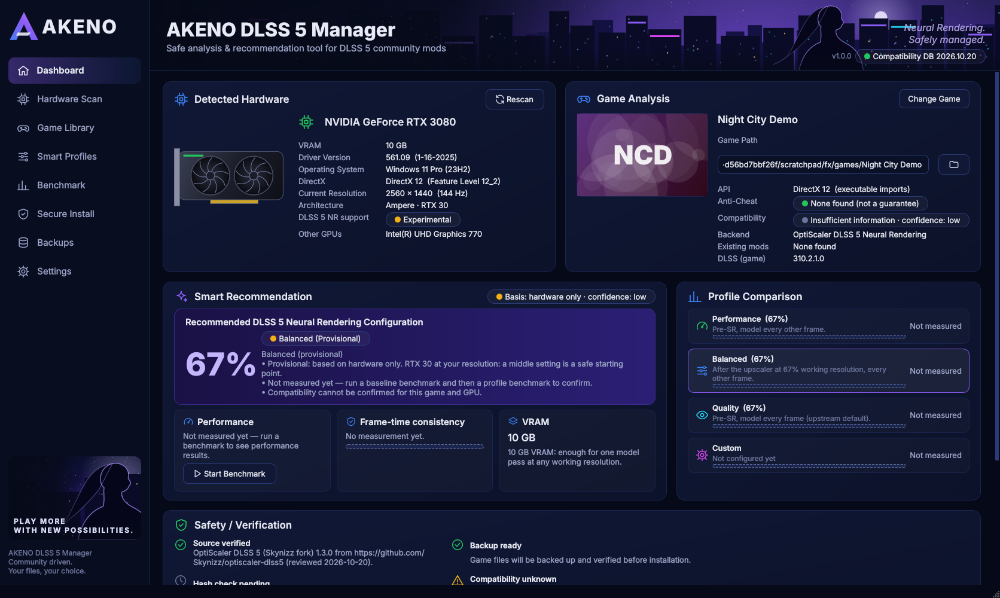

# AKENO DLSS 5 Manager

**v1.5 development branch:** graphical rendering pipeline planning, exact official DLL swaps, isolated runtime/consumer self-tests, source-identified NR counters, interrupted-transaction recovery and PresentMon capture without recurring automatic UAC prompts. Public builds contain no NVIDIA runtimes. See [implementation and limits](docs/AKENO_V1_5_IMPLEMENTATION.md), [19-project source research](docs/AKENO_V1_5_UPSTREAM_RESEARCH.md), and [RTX 5090/4080 hardware procedure](docs/AKENO_V1_5_HARDWARE_TESTS.md). Unreviewed RenoDX NR and legacy bridge combinations remain unavailable; no physical GPU/game success is claimed.


A Windows desktop launcher that makes DLSS 5 Neural Rendering community mods easier to understand,
safer to install and simple to undo — with honest answers about what works on your GPU.

> **Status:** v1.5 development — v1.4.1 fixes, official dependencies, restore chains and FiveM restrictions are retained.
> Current implementation, test/build evidence and incomplete integrations are recorded in [the v1.5 implementation notes](docs/AKENO_V1_5_IMPLEMENTATION.md). It has **not** yet been
> verified on a physical NVIDIA RTX GPU; what has and has not been verified is listed in
> [docs/STATUS.md](docs/STATUS.md). Please read it before relying on any feature.

AKENO is an independent community project. It is **not affiliated with NVIDIA**, OptiScaler,
DLSS5-Feeder or any game publisher. DLSS 5 Neural Rendering mods drive an undocumented NVIDIA feature:
nothing about them is officially supported.



*Rendered by the app itself (1920x1080 window) with synthetic test-fixture data (an RTX 5090 system) — see
[docs/screenshots](docs/screenshots/README.md). Not a concept image.*

## What's new in 1.1

* **AKENO design**: the original anime/cyberpunk artwork (header, recommendation scene, sidebar landscape,
  GPU illustration, logo and icons) is bundled and drawn behind real, data-driven widgets. The dashboard
  fits a maximised 1920x1080 window, the action buttons stay pinned and reachable at 125–150 % scaling,
  and ultrawide windows keep the content centred.
* **Resolve Dependencies**: AKENO searches your NVIDIA driver (DriverStore, System32, NGX model store,
  extracted driver packages), your installed games and a few documented folders for NVIDIA's runtimes,
  imports only unmodified NVIDIA-signed copies, and downloads the reviewed open-source packages — after
  you confirm the list. What cannot be obtained lawfully is explained with the shortest fix.
  See [docs/DEPENDENCIES.md](docs/DEPENDENCIES.md).
* **Install wizard**: System · Game · Dependencies · Installation, one line per check, details on click,
  the exact blocking reason, progress, cancel and automatic rollback.
* **GPU support report**: official vs. community status per RTX generation, the difference between
  Super Resolution, Ray Reconstruction, Frame Generation, Multi Frame Generation and Neural Rendering,
  and a real on-PC verification read from the game's logs after you played once.
* **Complete German UI**, including messages that contain game names, versions and paths.

## What it does

| Page | What you get |
|---|---|
| **Dashboard** | Detected GPU, game analysis, the recommended configuration, measured performance, profile comparison, safety checks and one-click actions. |
| **Hardware Scan** | Every GPU (multi-GPU aware) via DXGI, the display-driver registry and NVML: PCI IDs, architecture, Tensor Cores, VRAM, driver version/date, D3D12 feature level, displays. Neural Rendering support report and DLSS technology matrix. Diagnostic export. |
| **Game Library** | Games from Steam (all libraries), Epic, GOG, Ubisoft Connect, EA app and Xbox/Microsoft Store, plus manual folders. Search, sort, filter, per-game executable/API overrides, mod and anti-cheat detection. |
| **Smart Profiles** | Performance / Balanced / Quality / Custom built only from settings the backend really has (e.g. OptiScaler `[DlssNr] WorkingScale`, `PreSr`, `CacheInterval`). Apply to an installed backend. |
| **Benchmark** | Real frame-time capture with Intel PresentMon, CSV import, avg/1%/0.1% low, percentiles, frame-time graphs, comparisons, CSV/JSON export. |
| **Secure Install** | Wizard with grouped checks (System, Game, Dependencies, Installation), **Resolve Dependencies** (verified NVIDIA runtime import from your own PC, reviewed package downloads), and a transactional installation with backup, validation and automatic rollback. |
| **Backups** | Every installation and manual snapshot, files affected, logs, restore and delete. |
| **Settings** | English/German, appearance, updates, cache, backups, benchmark defaults, FPS target, notifications, logging, safety defaults, factory reset. |

### Honesty rules built into the code

* Neural Rendering is treated as a **visual** technology that costs performance. AKENO never claims it
  raises FPS. Super Resolution, Frame Generation and Multi Frame Generation are separate things.
* Performance numbers are either **measured** (PresentMon or an imported CSV), **estimated** (only from
  your measured baseline and the per-preset cost the upstream project published, labelled as such) or
  shown as *"Not measured yet"*. There are no made-up stability or quality scores.
* The big percentage on the dashboard is the backend's real **neural model working resolution**
  (`DlssNr.WorkingScale`), not a quality rating.
* Compatibility is *Confirmed*, *Experimental*, *Known incompatible*, *Insufficient information* or
  *Blocked for safety* — each with its evidence source, version, date and tested GPU. Games without
  evidence are "insufficient information", never "compatible".
* Green checkmarks appear only after the check really ran (e.g. "Hash check passed" only once the
  downloaded package matched its pinned SHA-256).
* "Leave Neural Rendering disabled" is a valid recommendation.

## Supported hardware

| GPU | Status in AKENO |
|---|---|
| NVIDIA RTX 50 (Blackwell) | Community-verified: upstream reports NVIDIA's signed runtime (310.8.0) creates the neural feature (RTX 5090, drivers 616.64 / 617.14). |
| NVIDIA RTX 40 / 30 / 20 | Experimental: upstream reports NVIDIA's **signed** `nvngx_dlssnr.dll` 310.8.0 refusing the neural feature on these generations (`0xbad00001`, [DLSS5-Feeder #131](https://github.com/jlrouzies-fr/DLSS5-Feeder/issues/131)). Other-game community reports do not establish the exact RTX 4080 runtime. v1.3 can use a separately reviewed, hash-pinned local community runtime in an eligible offline experiment. It never marks such a file NVIDIA-authenticated or infers neural evaluation from an SR swap. |
| NVIDIA GTX (no Tensor Cores), AMD, Intel | Detected and shown, marked unsupported with the reason. |

AKENO starts on any Windows 10/11 x64 PC; no NVIDIA library is needed to launch it.

## Backends

| Backend | APIs | AKENO automation |
|---|---|---|
| **OptiScaler DLSS 5** ([Skynizz/optiscaler-dlss5](https://github.com/Skynizz/optiscaler-dlss5) 1.3.0, built on Dagherbou's OptiScaler_DLSSNR) | DirectX 12, DirectX 11 (via dx11-on-12), Vulkan; 64-bit; game must already use DLSS, FSR 2+ or XeSS | Full: resolve dependencies (find + import your NVIDIA runtime, download + verify the package) → choose a free proxy name (`winmm.dll` … or `OptiScaler.asi` beside an ASI loader) → write configured `OptiScaler.ini` → back up → install → validate → record. |
| **DLSS5-Feeder** ([jlrouzies-fr/DLSS5-Feeder](https://github.com/jlrouzies-fr/DLSS5-Feeder) 1.19.0) | DirectX 9/11/12, OpenGL (32- and 64-bit); for games *without* DLSS | Partial: installs the feeder add-on/helper and shader once ReShade (with add-ons) and exactly one neural add-on are present. ReShade setup, Vulkan layer registration and in-overlay configuration remain guided manual steps. |
| Dagherbou/OptiScaler_DLSSNR | — | Listed only: no reviewed release hash, so installation is disabled. |

## Safety model

* **Only reviewed packages.** Downloads come from allow-listed GitHub hosts over HTTPS (redirects are
  re-checked) and must match the SHA-256 pinned in `akeno/data/catalog.json`. A hash supplied by the
  download source itself is never trusted. Archives are inspected for path traversal, absolute paths,
  symlinks, reserved names, oversized members and zip bombs; only the named files are extracted and
  each is hash-checked again.
* **No scripts.** AKENO never runs downloaded `.ps1`, `.bat` or `.py` files.
* **No NVIDIA redistribution.** NVIDIA runtimes come only from your own PC (NVIDIA driver, NGX store,
  your games, or a file you pick), must name themselves as the runtime they are imported as, and must
  carry a valid NVIDIA Authenticode signature in the official workflow. The separate community manager requires explicit local review/permission, exact pins and offline scope; community files never pass that official signature gate or enter its global runtime table. No proprietary runtime is bundled or automatically downloaded.
* **Anti-cheat = blocked.** Known anti-cheat files (EAC, BattlEye, Vanguard, …) or a database entry block
  installation. "None found" is never presented as proof that a game has no anti-cheat.
* **Transactional installs.** Game not running → permissions → conflicts → dependencies → summary →
  your confirmation → verified backup → atomic writes → validation → record. Any failure rolls back.
  Files AKENO did not install are never overwritten or deleted; conflicting neural add-ons are only
  renamed (`*.akeno-disabled`) with your explicit approval, and renamed back on uninstall.
* **No elevation for game folders**, no antivirus exclusions, no Defender/Secure Boot changes, no
  process hiding or injection by AKENO itself.

## Installation (for players)

1. Open the latest successful run of the **Build and test** workflow in the repository's *Actions* tab
   and download the artifact **AKENO-DLSS5-Manager-windows-x64**.
2. Run `AKENO-DLSS5-Manager-<version>-Setup-x64.exe` (per-user install, no admin rights), or unzip the
   portable ZIP anywhere and start `AKENO.exe`. Python is not required.
3. Verify the files against `SHA256SUMS.txt` from the same artifact if you like.

The builds are not code-signed, so Windows SmartScreen may warn on first start.

**Uninstalling AKENO keeps `%LOCALAPPDATA%\AKENO`** (settings, install records and the backups of your
game files) so mods can still be restored. Restore your games first if you want to remove everything,
then delete that folder.

## First steps

1. **Dashboard → Scan Hardware.** Check that your RTX GPU and driver are shown. *Hardware Scan* shows
   what your GPU generation can and cannot do.
2. **Game Library.** Pick your game. If the graphics API shows *Unknown*, select it.
3. **Benchmark.** Start the game, then record a *Baseline* run.
4. **Secure Install → Resolve Dependencies.** Review the list (imports from your NVIDIA driver, package
   download with size and licence) and confirm. Anything AKENO may not obtain is explained with a link.
5. **Secure Install → Install.** Review the summary and confirm. A verified backup is made first.
6. Benchmark again with the installed profile. The recommendation switches from *provisional* to
   *measured* and can tell you to use a cheaper profile — or to leave Neural Rendering off.
7. **Restore** (Dashboard or Backups) puts the original files back at any time.

Use mods only in offline / single-player games.

## Building from source

Requirements: Windows 10/11 x64, Python 3.12.

```powershell
pip install -r requirements-dev.txt
python -m pytest                       # unit, integration and offscreen UI tests
python -m akeno                        # run from source
python packaging\make_icon.py          # application icon (original artwork)
pyinstaller --noconfirm packaging\akeno.spec      # -> dist\AKENO\AKENO.exe
iscc /DAppVersion=1.3.0 packaging\installer.iss   # -> packaging\out\...Setup-x64.exe (Inno Setup 6)
```

`python -m akeno --smoke-test` scans real hardware, games and NVIDIA runtimes, checks the bundled design
assets, builds every page and exits; `--screenshot DIR [--screenshot-size 1920x1009]
[--screenshot-scale 1.5]` saves a PNG of every page. The CI workflow (`.github/workflows/build.yml`) runs all
of this on a Windows runner and publishes the installer, portable ZIP, checksums, test results and
screenshots as artifacts. Tests also run on Linux with an offscreen Qt platform; on Linux the
application starts but hardware detection, PresentMon and signature checks report that they need Windows.

## Project layout

```
akeno/
  app.py              entry point, logging, tray notifications, smoke-test / screenshot modes
  services.py         application facade used by the UI (no Qt)
  core/               models, SQLite store, settings, process inspection
  hardware/           DXGI / registry / NVML / display probes, GPU identification, support matrix + log verification
  games/              launcher scanners, VDF + PE parsers, game analysis, library
  compat/             compatibility database + engine
  recommend/          recommendation engine
  backends/           adapter interface, OptiScaler DLSS-NR, DLSS5-Feeder, NVIDIA runtime discovery/import, INI
  deps/               dependency resolver (plan, local import, verified downloads, guidance)
  security/           catalog, download manager, archive extraction, Authenticode
  install/            transactional installer, backups, snapshots, restore
  benchmark/          PresentMon runner, frame-time statistics, storage/export
  diagnostics/        diagnostic package export
  ui/                 theme (design tokens), asset loader, artwork fallbacks, icons, widgets, pages
  data/               catalog.json, compatibility.json, i18n_de.json, assets/ (AKENO design artwork)
packaging/            PyInstaller spec, Inno Setup script, icon generator
tests/                pytest suite (fixtures build synthetic PE files and game folders)
tools/                i18n extraction, fixture data for screenshots
docs/                 STATUS.md, ARCHITECTURE.md, DEPENDENCIES.md, DEVELOPMENT_PROGRESS.md
```

## Updating the data files

* `akeno/data/compatibility.json` — every game entry needs `evidence.source`, `url`, `date_verified`,
  the backend and status; the loader rejects entries without them. A newer database can be fetched from
  this repository in *Settings → Updates*; it never changes your settings or the package list.
* `akeno/data/catalog.json` — adding a package requires downloading the official release, reviewing its
  contents, and pinning the archive hash **and** the hash of every file AKENO extracts.

## License

GPL-3.0-or-later. See [LICENSE](LICENSE) and [THIRD_PARTY_NOTICES.md](THIRD_PARTY_NOTICES.md).

Validated v1.2 integration build, downloads, checksums and real-PC limits: [docs/BUILD_V1_2.md](docs/BUILD_V1_2.md).

Validated v1.3 source/build evidence, downloads and exact hashes: [docs/BUILD_V1_3.md](docs/BUILD_V1_3.md).

Bandukids-focused 1.3.1: named exact-hash local runtime review, unverified RTX 4080 profile and separately qualified FiveM recipe plumbing. ComfyUI video claims do not establish game support; no production FiveM recipe or binary-safety approval is shipped. [Review and guide](docs/BANDUKIDS_REVIEW.md) · [Progress](docs/BANDUKIDS_PROGRESS.md).


## v1.4 experimental installer branch

The v1.4 branch adds local offline bundles, controlled RTX 40/50 first tests without mandatory expert-review JSON, automatic opt-in diagnostics/PresentMon measurement, and an isolated FiveM development-validation workflow. Official NVIDIA verification remains separate. No proprietary NVIDIA DLL is included in public packages. See [private offline packaging](docs/OFFLINE_BUNDLES.md) and [implementation and validation status](docs/AKENO_V1_4_PROGRESS.md). Hardware execution and FiveM plugin support require real evidence; fixture tests do not establish them.
