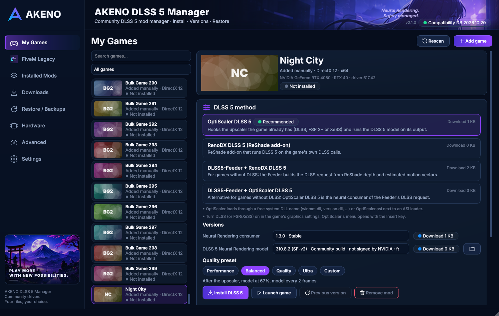

# AKENO Gaming Suite

**3.0** extends AKENO DLSS 5 Manager into a suite. One account and one license (24 hours, 72 hours, 30 days or Lifetime; codes stack) unlock every module:

| Section | Pages |
|---|---|
| HOME | Dashboard, My Games (with the Game Hub: favourites, categories, notes, launch options, playtime), Recently Played |
| GAMING | DLSS 5 Manager (everything of 2.1, unchanged), FPS Booster, Benchmark (baseline / boost / DLSS 5 comparison), Installed Mods |
| DESKTOP | Wallpapers (pictures, GIFs, videos, HTML/WebGL behind the desktop icons), AKENO Dock, Widgets, Theme Workshop |
| ONLINE | Community (presets and themes, data only, reviewed index), Cloud Sync (through a folder you choose) |
| ACCOUNT | My Account, License, Updates (signed, verified, with rollback), Settings |

Where each part runs:
- **Your PC:** everything, including the downloads from AKENO's **public release repository**, which need no GitHub account.
- **The license server (VPS):** accounts, licenses and the admin website, nothing else ([deploy/README.md](deploy/README.md)).

Licenses are Ed25519-signed by that server, bound to the PC and checked against the public key built into the app. A Lifetime license keeps working offline for good ([license trust model](docs/SECURITY_LICENSING.md)).

More: [Desktop Studio](docs/DESKTOP_STUDIO.md), [Cloud Sync and Community](docs/CLOUD_SYNC_AND_COMMUNITY.md), [distribution and updates](docs/DISTRIBUTION_AND_UPDATES.md), [3.0 release notes](docs/AKENO_V3_RELEASE_NOTES.md).

## DLSS 5 Manager

**Since 2.1:** a community mod manager for DLSS 5 Neural Rendering. Open **My Games**, pick a game, and AKENO
recommends the method and versions that fit it, downloads the original release files, verifies them,
installs and configures the complete stack, and takes it all back byte for byte when you remove it. Presets
(Performance, Balanced, Quality, Ultra, Custom) map to the mods' real settings. FiveM Legacy has its own page.

AKENO is an independent community project. It is **not affiliated with NVIDIA**, OptiScaler, DLSS5-Feeder,
RenoDX, dgVoodoo2, Cfx.re or any game publisher. DLSS 5 Neural Rendering mods drive an undocumented NVIDIA
feature: nothing about them is officially supported.



*Rendered by the application with synthetic fixture data (CI screenshots; no hardware evidence).*

## What it installs

| Game | Method | What goes where |
|------|--------|-----------------|
| 64-bit, with DLSS / FSR 2+ / XeSS | **OptiScaler DLSS 5** (Skynizz 1.3.0, Dagherbou 0.2.0) | OptiScaler under a free proxy name, `OptiScaler.ini` from the preset, the DLSS 5 model |
| 64-bit, with DLSS | **RenoDX DLSS 5** (7.0.0-rc8, 8.5.0-rc10, 6.5.3) | ReShade 6.8.0 with add-on support, the add-on, the model; `EnableHooks=1` for Streamline games |
| 64-bit without DLSS (D3D11/12, OpenGL, Vulkan, D3D9) | **DLSS5-Feeder + RenoDX DLSS 5** (or + OptiScaler) | ReShade, Feeder 1.19.0 in-process, motion vectors (dh_uber_motion), SR + model; dgVoodoo2 for D3D9, `opengl32.dll` for OpenGL, a per-user Vulkan layer for Vulkan |
| **32-bit** (D3D11, D3D10, D3D9/D3D8, OpenGL, Vulkan/DXVK) | **DLSS5-Feeder 32-bit helper + RenoDX DLSS 5** | beside the game: 32-bit ReShade, `dlss5-feed.addon32`, shaders, dgVoodoo2 (D3D8/9); in `host64\`: `dlss5-feed-host64.exe`, 64-bit ReShade, RenoDX DLSS 5, SR + model |
| **FiveM Legacy** | **DLSS5-Feeder + RenoDX DLSS 5** in `FiveM.app\plugins` | ReShade as `d3d11.dll`, FiveM's own ReShade acknowledgement in `CitizenFX.ini`; GTA V is never touched |

The DLSS 5 model build follows your GPU: NVIDIA's signed 310.8.0 for RTX 50, the 310.8.2 SF-v2 community
build (RHI lists it for RTX 20–50) for RTX 20/30/40. Every build stays selectable; one that cannot run on
your GPU is blocked with an explanation. Details: [repairs in 2.1](docs/AKENO_V2_REPAIRS.md),
[FiveM review](docs/AKENO_V2_FIVEM_REVIEW.md), [audit](docs/AKENO_V2_CLAUDE_AUDIT.md),
[test results](docs/AKENO_V2_TEST_RESULTS.md).

### 32-bit games

NVIDIA ships NGX only as 64-bit code, so a 32-bit game cannot run DLSS itself. DLSS5-Feeder solves this with
a 64-bit helper: `dlss5-feed.addon32` in the game's 32-bit ReShade hands every frame over shared GPU textures
to `host64\dlss5-feed-host64.exe`, which runs NGX and the neural consumer. AKENO picks the transport from the
game's actual API and never combines incompatible stacks: `dxgi.dll` for Direct3D 10/11, dgVoodoo2 2.87.5
(Direct3D 8/9 to 11) plus `dxgi.dll` for Direct3D 8/9, `opengl32.dll` for OpenGL, and a Vulkan layer registered
for your Windows user only (no administrator rights) for Vulkan games and games running through DXVK. A suitable
machine-wide ReShade layer is reused. The game page can run the helper's own self-test, and a helper left
running after a crash is detected and can be stopped. Only DLAA is possible on this route.

## Safety model

* **Original files only.** Downloads come from the original GitHub releases (and reshade.me for the official
  ReShade setup) over HTTPS. Each archive and every file AKENO extracts is pinned to its SHA-256, and every
  binary is checked for its bitness. CI downloads every pinned asset and installs the real stacks into
  fixture folders.
* **Preview first.** Every file that is added, updated, replaced or disabled is listed before anything changes.
  Files of other mods are replaced or disabled only after you approve them, and come back on removal.
* **Transactions.** Originals are backed up and verified first; any failure rolls back. Removing a mod restores
  the game folder byte for byte, even after the mods rewrote their own config files while the game ran.
* **No scripts.** AKENO never runs downloaded `.bat`, `.ps1` or `.py` files. The only upstream program it can
  start is the Feeder helper's own self-test, on request.
* **Anti-cheat.** Games that ship anti-cheat need your confirmation that you play offline with the mod.
* **No elevation.** Game folders and the per-user Vulkan layer need no administrator rights.

## Installation (for players)

1. Open the latest successful run of the **Build and test** workflow in the repository's *Actions* tab and
   download the artifact **AKENO-DLSS5-Manager-windows-x64**.
2. Run `AKENO-DLSS5-Manager-<version>-Setup-x64.exe` (per-user install, no admin rights), or unzip the portable
   ZIP anywhere and start `AKENO.exe`. Python is not required.
3. Verify the files against `SHA256SUMS.txt` from the same artifact if you like.

The builds are not code-signed, so Windows SmartScreen may warn on first start.

**Uninstalling AKENO keeps `%LOCALAPPDATA%\AKENO`** (settings, install records and the backups of your game
files) so mods can still be removed cleanly. Remove the mods first if you want to delete everything.

## First steps

1. **My Games** lists what AKENO found (Steam, Epic, GOG, Ubisoft, EA, Xbox, FiveM) or what you added.
2. Pick a game. AKENO shows the recommended method, the versions it will use and the preset for your GPU.
3. **Install DLSS 5** shows the preview; confirm it. Downloads are cached, so reinstalling, up- or downgrading
   and switching back work offline.
4. **Launch game.** In game, open the ReShade overlay (Home) or OptiScaler's menu (Insert) as the page says.
5. Change the preset at any time; only the config files are rewritten. **Previous version** goes back one
   install, **Remove mod** restores the original files.

## Building from source

Requirements: Windows 10/11 x64, Python 3.12.

```powershell
pip install -r requirements-dev.txt
python -m pytest                       # unit, integration and offscreen UI tests
python -m akeno                        # run from source
python packaging\make_icon.py          # application icon (original artwork)
pyinstaller --noconfirm packaging\akeno.spec      # -> dist\AKENO\AKENO.exe
iscc /DAppVersion=2.1.0 packaging\installer.iss   # -> packaging\out\...Setup-x64.exe (Inno Setup 6)
```

`python -m akeno --smoke-test` scans real hardware, games and NVIDIA runtimes, checks the bundled design
assets, builds every page and exits; `--screenshot DIR [--screenshot-size 1920x1009]
[--screenshot-scale 1.5]` saves a PNG of every page. The CI workflow (`.github/workflows/build.yml`) runs all
of this on a Windows runner and publishes the installer, portable ZIP, checksums, test results and
screenshots as artifacts. Tests also run on Linux with an offscreen Qt platform; on Linux the
application starts but hardware detection, PresentMon and signature checks report that they need Windows.

## Project layout

```
akeno/
  app.py              entry point, logging, tray notifications, smoke-test / screenshot modes
  services.py         application facade used by the UI (no Qt)
  core/               models, SQLite store, settings, process inspection
  hardware/           DXGI / registry / NVML / display probes, GPU identification, support matrix + log verification
  games/              launcher scanners, VDF + PE parsers, game analysis, library
  compat/             compatibility database + engine
  recommend/          recommendation engine
  stack/              2.x mod engine: catalog, downloads, transports, planner, install service
  backends/           adapter interface, OptiScaler DLSS-NR, DLSS5-Feeder, NVIDIA runtime discovery/import, INI
  deps/               dependency resolver (plan, local import, verified downloads, guidance)
  security/           catalog, download manager, archive extraction, Authenticode
  install/            transactional installer, backups, snapshots, restore
  benchmark/          PresentMon runner, frame-time statistics, storage/export
  diagnostics/        diagnostic package export
  ui/                 theme (design tokens), asset loader, artwork fallbacks, icons, widgets, pages
  data/               catalog.json, compatibility.json, i18n_de.json, assets/ (AKENO design artwork)
packaging/            PyInstaller spec, Inno Setup script, icon generator
tests/                pytest suite (fixtures build synthetic PE files and game folders)
tools/                i18n extraction, fixture data for screenshots
docs/                 STATUS.md, ARCHITECTURE.md, DEPENDENCIES.md, DEVELOPMENT_PROGRESS.md
```

## Updating the data files

* `akeno/data/compatibility.json` — every game entry needs `evidence.source`, `url`, `date_verified`,
  the backend and status; the loader rejects entries without them. A newer database can be fetched from
  this repository in *Settings → Updates*; it never changes your settings or the package list.
* `akeno/data/catalog.json` — adding a package requires downloading the official release, reviewing its
  contents, and pinning the archive hash **and** the hash of every file AKENO extracts.

## License

GPL-3.0-or-later. See [LICENSE](LICENSE) and [THIRD_PARTY_NOTICES.md](THIRD_PARTY_NOTICES.md).

Validated v1.2 integration build, downloads, checksums and real-PC limits: [docs/BUILD_V1_2.md](docs/BUILD_V1_2.md).

Validated v1.3 source/build evidence, downloads and exact hashes: [docs/BUILD_V1_3.md](docs/BUILD_V1_3.md).

Bandukids-focused 1.3.1: named exact-hash local runtime review, unverified RTX 4080 profile and separately qualified FiveM recipe plumbing. ComfyUI video claims do not establish game support; no production FiveM recipe or binary-safety approval is shipped. [Review and guide](docs/BANDUKIDS_REVIEW.md) · [Progress](docs/BANDUKIDS_PROGRESS.md).


## v1.4 experimental installer branch

The v1.4 branch adds local offline bundles, controlled RTX 40/50 first tests without mandatory expert-review JSON, automatic opt-in diagnostics/PresentMon measurement, and an isolated FiveM development-validation workflow. Official NVIDIA verification remains separate. No proprietary NVIDIA DLL is included in public packages. See [private offline packaging](docs/OFFLINE_BUNDLES.md) and [implementation and validation status](docs/AKENO_V1_4_PROGRESS.md). Hardware execution and FiveM plugin support require real evidence; fixture tests do not establish them.
