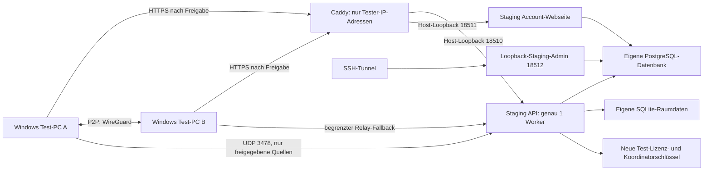

# AKENO Network – geprüfte VPS-Staging-Vorbereitung

> Historischer Vorbereitungsstand. Nachfolgend wurde ausschließlich der lokale Smoke-Test freigegeben und ausgeführt. Aktueller Betriebs-/Schlüsselstand: `AKENO_NETWORK_LOCAL_SMOKE_REPORT.md`, `CLAUDE_LOCAL_STAGING_HANDOFF.md`. Öffentliche Aktivierung bleibt gesperrt.
Stand: **28.10.2026, Europe/Berlin**. Ergebnis: **Vorbereitung fertig; kein Staging deployed und keine öffentliche Freigabe.** Es wurden keine Produktionscontainer ersetzt/neu gestartet, keine Firewall-/DNS-/Caddy-Regeln geändert, keine produktiven Benutzer/Lizenzen/Datenbanken geschrieben und keine Produktionsschlüssel kopiert. Nur isolierte kurzlebige Testcontainer ohne Netzwerk/Hostports und mit temporärer SQLite wurden ausgeführt.

## 1. Quellen und Branch

Untersucht: `claude/inspiring-gauss-i8vjdr`, festgehaltener Commit **`588b21ca64a78f13d937a89abb58d5289b34f7c5`**, Tree `0aa0d19ea28ad2728ba6e613fbf757928a3d507a`. Alle fünf verlangten Dokumente/Compose-Dateien gelesen, dazu tatsächliche Server-/Client-Implementierung. 116 gelesene Dateien entsprechen exakt den Git-Blob-Hashes (`SOURCE_IDENTITY.json`). Kein AGENTS.md im untersuchten Repository-Baum gefunden.

Eigener Vorbereitungsbranch: **`codex/akeno-network-staging-20261028`**. Checkpoints wurden über die GitHub-API geschrieben und der Remote-Ref jeweils zurückgelesen. Kein Merge, Tag, Release, Pull Request oder Deployment ausgelöst. Branch-Pushes können die vorhandene Test-CI starten; es wurde kein Workflow mit Veröffentlichungs-/Deploymentparametern angefordert. Letzten bestätigten Commit siehe `GITHUB_CHECKPOINT.json` im lokalen Übergabepaket und Branchhistorie. `PROGRESS.md` enthält den Fortschritt.

Die Version im untersuchten aktuellen Windows-Code ist **3.1.1**; dies ist keine neue AKENO-3.0-Releasefreigabe. Aussagen älterer Übergaben über Transportlücken wurden mit Claudes neuer Implementierung abgeglichen. Insbesondere ist der UDP-Koordinator tatsächlich implementiert; echte ISP-/Zwei-PC-Nachweise stehen weiterhin aus.

## 2. VPS-Bestandsaufnahme

Lesende Momentaufnahme vom **28.10.2026, 02:47 CET**:

| Bereich | Ergebnis |
|---|---|
| Host | Akeno, VPS IPv4 `85.190.112.10`, 4 virtuelle CPUs |
| RAM | 7.75 GiB gesamt, ca. 6.12 GiB verfügbar, kein Swap |
| Datenträger | ca. 193 GiB gesamt, 174 GiB verfügbar, 10 % belegt |
| Produktive API/Web/Admin | drei gesunde Container, Image `akeno-licensing:website-redesign-20261027.3` |
| Bestehende Vorschauen | `akeno-redesign-before` und `akeno-redesign-after`, Loopback 8489/8490; bleiben erhalten |
| Datenbank | PostgreSQL **16.15**, 19 öffentliche Anwendungstabellen, kein veröffentlichter DB-Port |
| Backup | eigener laufender Container; letzter Erfolg 28.10.2026, **01:31:20 CET**; DB-Dump/Key-/Config-Archive lesbar indiziert |
| Reverse Proxy | bestehender Caddy auf TCP 80/443, Admin-API nur Host-Loopback |
| HTTPS | Webseite, Admin-Login und API erfolgreich über normales vertrauenswürdiges TLS erreichbar |
| API-Health/Ready | HTTP 200; Datenbank und Lizenzsignierschlüssel melden bereit |
| SMTP | produktiv `host272.checkdomain.de`, SSL; Zugangsdaten weder gelesen/ausgegeben noch übernommen; keine Nachricht versandt |
| Netzwerkfunktion produktiv | `network_enabled=false`, leerer Koordinator-Bind; bleibt unverändert |
| Release-Prüfschlüssel | bestehendes Ed25519-Key-ID `d6139235b220a4aa`, öffentlich unverändert abrufbar |
| Firewall | UFW aktiv, INPUT/Forward standardmäßig Drop; freigegeben TCP 22/80/443 für IPv4/IPv6; DOCKER-USER leer |

Bestehende Dienste: Docker/containerd, Caddy, PostgreSQL im Container, Backup-Container, SSH, Chrony und reguläre OS-Dienste. Keine vorhandenen WireGuard-/VPN-/LAN-Serverprozesse festgestellt. Eine Momentaufnahme ist kein Auslastungs-/Kapazitäts-Langzeittest; vorhandene Preview-Container zeigten zeitweise CPU-Verbrauch und wurden nicht verändert.

Belegte relevante Ports: TCP 22, 80, 443 öffentlich; 2019, 8410/8411/8412, 8489/8490 und weitere lokale System-/SSH-Hilfslistener auf Loopback. DNS lokal 53, DHCP/NTP-Systemports vorhanden. **UDP 3478 sowie TCP 18510–18512 waren frei.** Alle Listener stehen in `VPS_INVENTORY.json`.

Die aktuelle Backup-Automatisierung sichert DB, Lizenzschlüssel und Konfiguration; der Release-Privatschlüsselzweig ist weiterhin entfernt. Backupmetadaten nennen keinen Release-Key-Export. Keine Sicherung gestartet, keine Retention ausgelöst. Der Indexcheck ersetzt keinen neuen vollständigen Restore-Test; dieser bleibt für eine spätere Staging-Sicherung separat erforderlich.

## 3. Eigenständige Staging-Architektur

Die Konfiguration ist **kein Override der Produktionsdatei**, sondern eine vollständige eigene Compose-Datei mit festem Projektnamen `akeno-network-staging`, eigenen benannten Volumes und zwei neuen Netzen. Keine externen Produktionsvolumes oder -netze. PostgreSQL ist nur im internen Datenbanknetz erreichbar; die drei Apps haben zusätzlich ein eigenes Control-Netz. Kein Docker-Socket, Hostnetz, `/dev/net/tun`, `privileged` oder `NET_ADMIN`. Die API benötigt kein Kernel-WireGuard: der begrenzte Koordinator arbeitet im normalen UDP-Prozess.

Neue Netze: `172.30.78.0/28` (Control), `172.30.78.16/28` (interne DB); aktuell kein Konflikt mit bestehenden Docker-Netzen. Vor Start auch Host-/VPN-Routen erneut prüfen. App-Schreibbereiche beschränken sich auf eigene Schlüssel, Datei-Mailausgang, Raumdaten und begrenztes tmpfs. Root-Dateisystem read-only, Apps UID 10001, Capabilities entfernt, No-New-Privileges. Der kurzlebige Initialisierer bekommt nur CHOWN/FOWNER auf neue Staging-Volumes und kein Netzwerk. PostgreSQL bekommt ausschließlich die für seinen offiziellen Entrypoint benötigten Initialisierungs-Capabilities.

Eigene Testkeys entstehen **erst nach Freigabe**: Ed25519 für Staging-Lizenzen/Peer-Tickets, X25519 für den WireGuard-Koordinator. Release-Schlüssel werden weder benötigt noch erzeugt. Die Lizenz-/LAN-Trust-Root ist innerhalb Staging dieselbe (entspricht dem aktuellen Clientvertrag), aber vollständig getrennt von Produktion. Der öffentliche Release-Prüfschlüssel im Windows-Build bleibt unverändert.

Zwei normale synthetische Testaccounts mit begrenzter Lizenz werden durch einen einmaligen Helfer vorbereitet; derzeit existieren sie nicht. Keine automatische Adminidentität. SMTP ist absichtlich nicht angeschlossen; Nachrichten gehen nur in ein separates Datei-Mailverzeichnis. Produktive Backups/Benutzer werden nicht geklont.

## 4. Ports und DNS – vorgeschlagen, nicht eingerichtet

| Zweck | Vorgesehener Wert | Status / Schutz |
|---|---|---|
| Staging API | Host `127.0.0.1:18510` → Container TCP 8000 | nur Loopback in Basisdatei |
| Staging Webseite | Host `127.0.0.1:18511` → TCP 8000 | nur Loopback |
| Staging Admin | Host `127.0.0.1:18512` → TCP 8000 | nur SSH-Tunnel, kein öffentlicher Adminhost |
| Datenbank | intern TCP 5432 | kein Hostport |
| Koordinator + Relay | Host `127.0.0.1:3478` → UDP 3478 | in Basisdatei lokal; separates öffentliches Override gesperrt, bis freigegeben |
| Externer API-/Webzugriff | bestehendes TCP 443 über neue Hostnamen | später TLS plus Tester-IP-ACL; keine bestehende Hostroute verändert |
| Windows-Latenzprobe | UDP 51999 innerhalb des LAN-Tunnels | kein VPS-Port und keine globale Windows-Freigabe |

Vorgesehene A-Records, jeweils VPS IPv4/TTL 300: `lan-staging-api.akeno.online`, `lan-staging.akeno.online`, `lan-staging-udp.akeno.online`. Alle drei waren bei der Prüfung nicht auflösbar. Kein Record angelegt, keine Zertifikatsanforderung gestartet. Keine AAAA-Records oder TCP-3478-Freigabe nötig. Details und später einzeln zu prüfende Firewallregeln: `FIREWALL_REVIEW.md`.

**UDP 3478 ist tatsächlich nötig**, wenn der aktuelle Datenpfad genutzt werden soll: der Socket bindet daran und der Heartbeat bewirbt diesen Port. Es ist kein anonymer STUN-/TURN-Dienst. Authentifizierte WireGuard-Handshakes beweisen das registrierte Gerät/den NAT-Endpoint; Relay nur zwischen frischen Mitgliedern desselben Raums. Die äußere Portnummer muss zur inneren passen, weil der aktuelle Code keinen separaten Advertised-Port hat.

## 5. Ressourcen und verbleibende Sicherheitsgrenzen

| Dienst | RAM-Limit | CPU-Limit | PID-Limit |
|---|---:|---:|---:|
| API + Koordinator | 512 MiB | 0.75 CPU | 96 |
| Web | 256 MiB | 0.25 CPU | 96 |
| Admin | 256 MiB | 0.25 CPU | 96 |
| PostgreSQL | 512 MiB | 0.50 CPU | 80 |
| Initialisierung, nur kurzzeitig | 64 MiB | 0.10 CPU | 16 |

Dauerhaft maximal **1.5 GiB RAM und 1.75 CPU** zuzüglich Docker-/Kernel-Overhead. Memory-Swap-Limit entspricht RAM-Limit; bei OOM beendet der Kernel den begrenzten Staging-Prozess. `restart: no` verhindert automatische Schleifen und unbewusste Wiederaufnahme eines öffentlich freigegebenen Tests. Reserviert werden sollten ca. 5 GiB für Image/Testdaten und zusätzlich klar begrenzte Backups; benannte Volumes haben in dieser Vorlage **keine harte Dateisystemquote**. Freiplatzalarme und manuelles Testende sind erforderlich.

Für zwei kontrollierte Tester reicht die aktuelle Momentaufnahme. Das ist **keine Freigabe für öffentlichen Relay- oder VPN-Exitbetrieb**. Staging teilt weiterhin Kernel, Hostdatenträger, Netzkarte, Provider-Anbindung und den bestehenden Caddy. Cgroups begrenzen nicht alle diese Ressourcen. Für unbekannte Nutzer, Lasttests, mehr Tester oder echte Länder-Exits separate Maschine verwenden; keine wurde bestellt.

Backendgrenzen: maximal 3 Räume pro Besitzer, 254 Raumsubnetze, 16 Peers/Raum, Invite 600 Sekunden, Raum 24 Stunden, Mitgliedslease 45 Sekunden; LAN-API IP 120/min, Nutzer 90/min, Join 10/min. UDP 400 Pakete/s je Quell-IP+Port, Header-/Größenprüfung, maximal ein gleich großes weitergeleitetes Paket; Grantfehler werden geschlossen behandelt. Es fehlen konfigurierbare globale/per-Account-Bandbreitenkontingente. Die geplante zusätzliche Source-IP-ACL und das gemeinsame 1.000-Pakete/s-Budget dürfen erst nach Prüfung eingerichtet werden. Sie sind hier nicht aktiv.

Die gesamte Relay-Produktionshärtung bleibt offen: verschiedene In-Memory-Tabellen, darunter Grant-/MAC-Zwischenspeicher, haben keine durchgängige feste Gesamtgrenze; ein erlaubter bösartiger Tester bleibt ein Missbrauchsrisiko. Der bestehende Memory-Cap schützt den reservierten Prozessspeicher, ersetzt aber keine Cache-/Account-Abuse-Härtung. Dies spricht für einen sehr kleinen, zeitlich begrenzten Test und gegen allgemeine Öffentlichkeit. Ein Koordinator muss in genau **einem** API-Worker bleiben; ein späteres Mehrprozess-Setup braucht einen getrennten Coordinator mit konsistenter Mitgliedschaftsautorität.

## 6. Durchgeführte Prüfungen

- Bestehende Dienste, Ressourcen, Ports, Firewallpfade, Docker-Netze, Backupmetadaten, PostgreSQL und HTTPS nur lesend untersucht.
- 116 Quelldateien gegen exakte Git-Blob-Identitäten geprüft.
- **26 Netzwerk-Backendtests bestanden**: echte kryptografische Handshakes, authentifizierte Raum-/Lizenz-/Gerätebindung, falsche Autorität, Widerruf, Lease, Relaygrenzen. Temporärer Testcontainer, kein Netzwerk, keine produktiven Mounts/DBs/Keys, keine echten E-Mails.
- **6 Vorbereitungstests bestanden**: Origin-/Rollen-/Umgebungs-/DSN-Abbruch, Secret-Dateiverarbeitung ohne Ausgabe, synthetische Standardnutzer mit Argon2id und befristeten Lizenzen, Verweigerung eines erneuten Seeds ohne Accountänderung.
- Compose syntaktisch validiert und `check-preparation.py` erfolgreich. Öffentlicher Override verweigert fehlende explizite IPv4 erwartungsgemäß; mit explizitem Wert ist die Konfiguration renderbar. Keine Ports geöffnet.
- Vorbereitete Caddy-Datei mit dem installierten Parser (`caddy adapt`) geprüft, nicht geladen. Kein Zertifikat ausgestellt.
- Produktions-Backupindizes von DB-Dump sowie Lizenzkey-/Config-Archiven geprüft; keine Inhalte/Secrets ausgegeben.

Noch **nicht** geprüft: wirklicher Staging-Build und Boot, PostgreSQL-Start mit diesen neuen Ressourcen-/Filesystem-Limits, wirkliche initiale Secrets-/Volume-Eigentümerübernahme, vollständiger Staging-Restore, ausgestellte Staging-TLS-Zertifikate, Provider-ACL, reale UDP-Erreichbarkeit und Zwei-PC-/Spiel-/UAC-/ISP-NAT-Test. Das sind bewusste spätere Aktivierungsprüfungen, nicht stillschweigend als bestanden gewertete Schritte.

## 7. Übergabe und Freigabegrenze

Dateien:

- `compose.staging.yml`, `.env.example`, `.gitignore`: eigener geschlossener Staging-Stack, ohne Secrets.
- `compose.public-udp.yml`: getrennte zukünftige Netzfreigabe, explizite IP erforderlich.
- `entrypoint.py`, `prepare-secrets.py`, `init-volumes.py`: bewusste spätere Initialisierung mit Abbruchregeln.
- `seed-test-users.py`, `prompt-test-passwords.py`: einmalige gewöhnliche Testkonten, Passwörter über direkten stdin-Pipe.
- `check-preparation.py`, `monitor-staging.py`: Konfigurationsprüfung bzw. späteres lesendes Monitoring.
- `Caddyfile.staging.example`, `FIREWALL_REVIEW.md`: nicht aktivierte Proxy-/Portvorlagen.
- `ACTIVATION_AND_ROLLBACK.md`: genaue Reihenfolge, Grenzen, Stop-/Backup-/Rollback-Anleitung.
- `WINDOWS_HANDOFF.md`, `configure-staging-client.ps1`: echte Endpoint-/Schlüssel-/Build-Anforderungen für Claude.
- `VPN_ARCHITECTURE.md`: getrennte spätere eigene Exit-Standorte; keine gekauften/gestarteten Server oder Fremdanbieter.
- `VPS_INVENTORY.json`, `SOURCE_IDENTITY.json`, Testprotokolle und `FINAL_READONLY_VERIFICATION.json`: tatsächliche Nachweise.

**Vor Aktivierung fehlen deine ausdrückliche Freigabe, die beiden öffentlichen Tester-IP-Adressen und ein Testzeitraum.** Danach müssen eigene Testkeys erzeugt/exportiert und in einen gesonderten Windows-Build integriert werden. Es gibt absichtlich noch keine vorgetäuschten öffentlichen Testkeys, keine produktiven Testkonten, keinen öffentlich erreichbaren Relay-/VPN-Dienst und kein automatisch gestartetes Deployment.

## 8. Abschließender Erhaltungsnachweis

`FINAL_READONLY_VERIFICATION.json` bestätigt: **alle sieben vorhandenen Container** mit identischer ID, Image, Startzeit und Restart-Zähler; **alle 19 Produktions-Tabellen** inhaltlich identisch; die vier geprüften produktiven Konfigurationsdateien samt .env unverändert; UFW-, IPv4-/IPv6-iptables- und DOCKER-USER-Regeln identisch. Keine Staging-Container, -Netze oder -Volumes und kein Laufzeit-.env/Secret-Verzeichnis angelegt. Produktive HTTPS-Seiten und API-Health/Ready liefern weiterhin HTTP 200. Öffentlicher Release-Key unverändert.

Die vorbereitete PostgreSQL-Konfiguration ist auf den lokal vorhandenen offiziellen Digest `postgres:16-alpine@sha256:f4610795587492cd4fb887c2dc3de301b813278bb6f616992061141b5f15ac36` festgelegt und lädt keine andere Version automatisch nach. Das App-Image muss nach einer später genehmigten Erstellung ebenfalls mit seiner Image-ID/Digest festgehalten werden.

Detaillierte Hostinventur und Erhaltungsnachweise bleiben im lokalen Übergabepaket; auf GitHub liegen die überprüfbaren Vorlagen, Tests, öffentliche Source-Identitäten und Dokumentation. Private Betriebsdateien oder Datenbankinhalte wurden nicht hochgeladen.

Die sieben vorhandenen GitHub-Workflows wurden gelesen: Branch-Pushes starten CI auf Runnern, keinen VPS-Deploy. Veröffentlichung/Draft-Erstellung erfordern Tags bzw. ausdrücklich gesetzte manuelle Workflow-Eingaben; solche Ereignisse wurden nicht ausgelöst. Keine Workflow-Datei wurde geändert.
