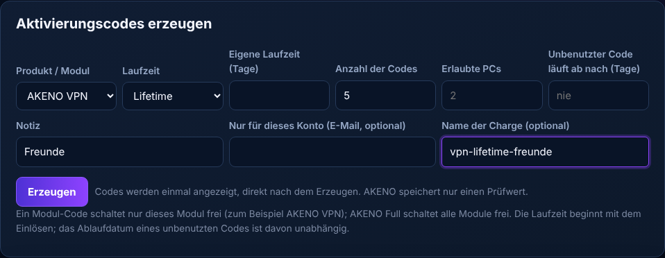
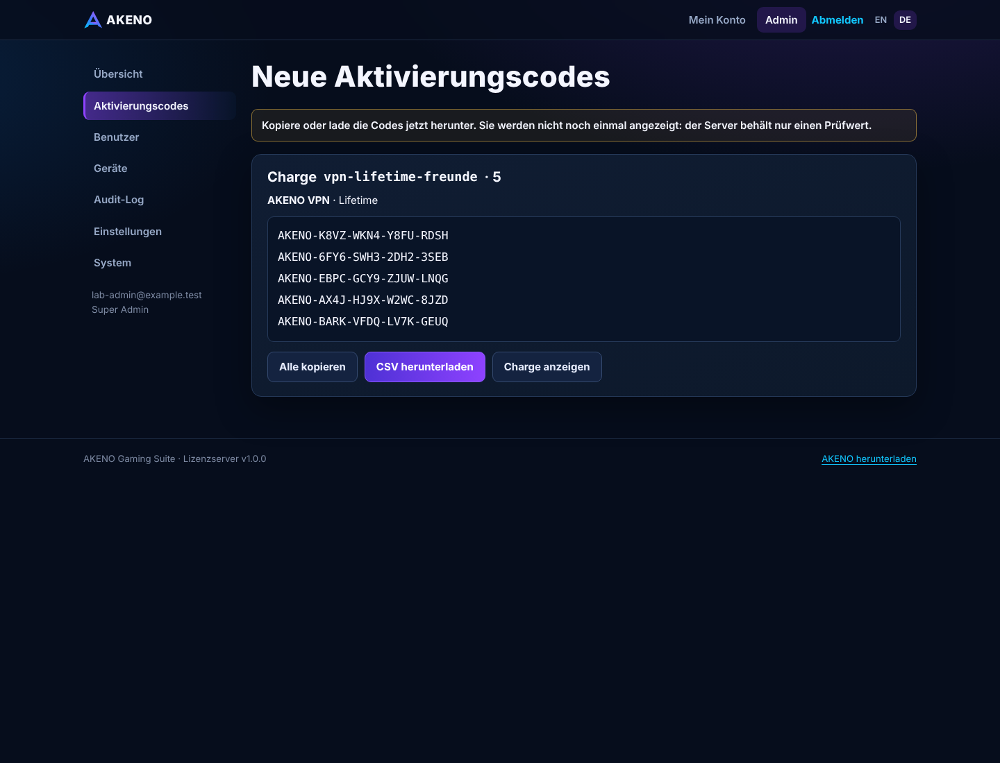
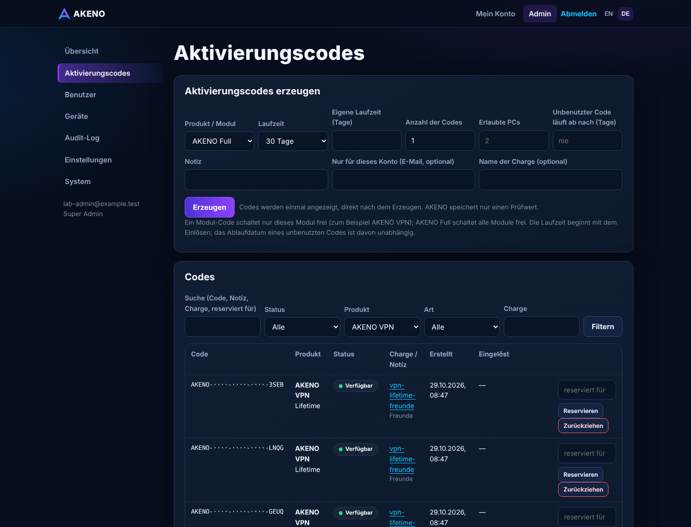
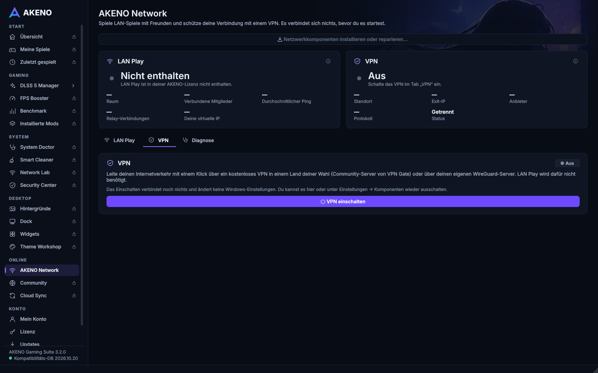
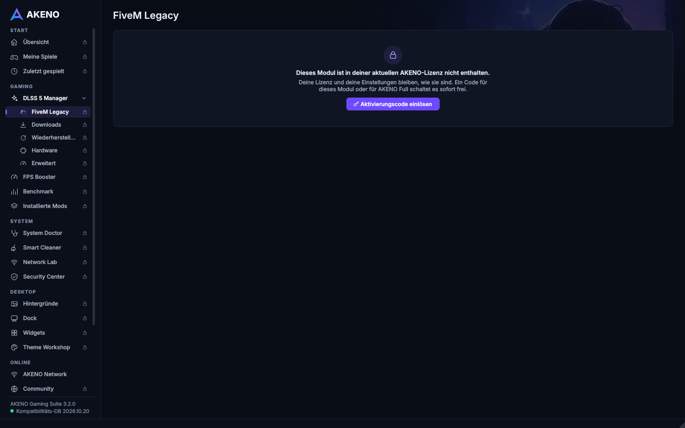
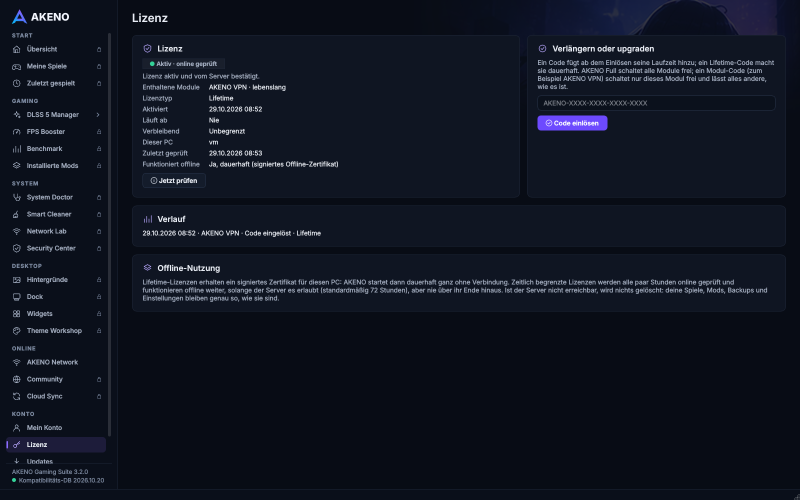
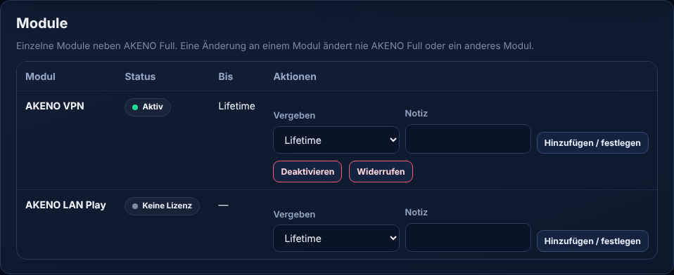

# AKENO Gaming Suite 3.2.0 — Feature-Lizenzen (AKENO VPN Lifetime): Abschlussbericht

Stand 29.10.2026. Branch **`claude/akeno-feature-licenses`** (Basis: `claude/akeno-free-vpn` @ `c6faf9d`, neuester
Stand inkl. 3.2.0, Free VPN, LAN Play). Commit und CI-Links: Abschnitt „CI auf dem finalen Commit“.
**Nichts wurde veröffentlicht, signiert, gemergt, deployt oder auf dem VPS/der produktiven Datenbank geändert.**
Keine neuen Release-Schlüssel, keine Secrets im Repository.

> **Ergebnis:** Ein Nutzer bekommt einen Code „AKENO VPN · Lifetime“, installiert die normale AKENO Gaming Suite,
> meldet sich an, löst den Code ein und kann AKENO VPN nutzen; alle anderen bezahlten Module bleiben gesperrt
> (sichtbar mit Schloss). Ein späterer Code für LAN Play oder AKENO Full schaltet weitere Module frei. Bestehende
> Full-Lizenzen und AKENO 3.1.1 funktionieren unverändert. Auf echtem Windows bewiesen: 19/19 Prüfungen, inklusive
> einer echten VPN-Verbindung für eine VPN-only-Lizenz über den echten Netzwerk-Helfer.
>
> **Veröffentlichung:** erst nach (1) VPS-Migration mit deiner Freigabe, (2) Offline-Signatur, (3) für **AKENO-VPN-
> Lizenzen** zusätzlich nach geklärter Nutzungserlaubnis von VPN Gate. Bis dahin sind VPN-Lizenzen im Admin-Panel
> gesperrt (Schalter aus); LAN-Play- und Full-Codes sind davon unabhängig.

## 1. Version

Live ist **3.1.1** (Production-Check [40845697547](https://github.com/YTDxDAkeno/AKENO-DLSS-5-Manager/actions/runs/40845697547):
„live stable 3.1.1 … sequence 3“, 14/14). 3.2.0 ist unveröffentlicht → die Feature-Lizenzen sind Teil des
**3.2.0-Release-Kandidaten**.

## 2. Neue Lizenztypen

| Lizenz | Berechtigung (`ent`) | Code im Admin-Panel |
|---|---|---|
| AKENO Full Lifetime / 30 / 90 / 365 / eigene Tage (+ Tests 24 h/72 h) | `akeno-suite` (alle Module, auch künftige) | Produkt „AKENO Full“ |
| AKENO VPN Lifetime / 30 / 90 / 365 / eigene Tage | `akeno-vpn` (nur VPN) | Produkt „AKENO VPN“ (gesperrt bis zur Freigabe) |
| AKENO LAN Play Lifetime / 30 / 90 / 365 / eigene Tage | `akeno-lan-play` (nur LAN Play) | Produkt „AKENO LAN Play“ |
| vorbereitet, nicht angeboten | `akeno-desktop-studio`, `akeno-dlss`, `akeno-performance`, `akeno-gaming-tools` | — |

Kombinationen (alle getestet): VPN allein · VPN + LAN · Full · **VPN Lifetime + Full 30 Tage → nach Ablauf wieder VPN
only** · Full Lifetime + Modul-Code → Code wird abgelehnt und bleibt unbenutzt („bereits enthalten“). Ein Code zerstört
nie eine stärkere/längere Berechtigung: Zeit addiert sich ab dem späteren Ende; Lifetime wird nie verkürzt.

## 3. Datenbank (Migration `0002`, additiv)

* `feature_grants` (Konto × Modul: lifetime/timed, active/disabled/revoked, Ablauf, PC-Limit; eindeutig je Konto und
  Modul), `feature_grant_events` (Verlauf).
* `license_codes` + `entitlement` (Standard `akeno-suite`) + `duration_days`; `license_redemptions.license_id`
  optional + `grant_id`; `offline_certificates` + `user_id` + `entitlements`, `license_id` optional.
* Die AKENO-Full-Lizenz bleibt die bisherige `licenses`-Zeile: **keine** Umschreibung vorhandener Lizenzen.
* SQLite (Tests/lokal) und PostgreSQL 16 (CI); Upgrade mit vorhandenen 3.1-Daten erhält alle Werte; Downgrade zieht
  unbenutzte Modul-Codes zurück. Anleitung, Prüfung, Rückweg: `docs/FEATURE_LICENSES_VPS_MIGRATION.md`.

## 4. Neue Admin-Funktionen (bestehendes Admin-Panel und Admin-API)

* **Aktivierungscodes:** Produkt/Modul, Laufzeit (Lifetime, 30, 90, 365, benutzerdefiniert, Tests nur Full), Anzahl
  (1–500), PCs, optionales Konto, Notiz, Charge, optionales Ablaufdatum des **unbenutzten** Codes (getrennt von der
  Laufzeit). Codes einmal sichtbar + einmaliger CSV-Export (Produkt, Laufzeit), danach nur Prüfwert und `…ABCD`.
  Liste filterbar nach Produkt.
* **Benutzer:** Karte „AKENO Full“ (wie bisher) und Karte „Module“: je Modul Status, Ablauf, Vergeben (Lifetime/30/
  90/365), Verlängern, Deaktivieren, Aktivieren, Widerrufen; gemeinsamer Verlauf (Full + Module), Audit-Einträge
  `grant.*`. Ein Modul widerrufen ändert nie Full oder andere Module.
* **Rollen:** Codes/Vergeben/Verlängern ab Admin, Status ab Admin (wie Lizenzen), Support nur lesen; der Schalter
  „AKENO-VPN-Lizenzen dürfen ausgegeben werden“ nur Super-Admin. 2FA-Pflicht und Audit unverändert.
* **Admin-API:** `POST /admin/codes/generate` (`entitlement`, `duration_days`), `GET /admin/codes?entitlement=`,
  `POST /admin/users/{id}/grants`, `…/grants/extend`, `…/grants/status`; Benutzer-Details mit `access`.
* `akeno-server check` zeigt jetzt Schema-Stand und Datensatz-Zahlen; neu `akeno-server migrate-down` (nur Rückweg).

## 5. Neue Client-Funktionen (Windows)

* **Gleicher Installer, gleicher Updater** für alle Lizenzen; die signierte Lizenz bestimmt die Module.
* **VPN-only:** AKENO startet auf *AKENO Network* (VPN-Tab). Verfügbar: AKENO VPN (kostenloses VPN, Länder,
  Verbinden/Trennen, Diagnose, Einstellungen), Konto, Lizenz/Code einlösen, Updates, Einstellungen, Hilfe.
  Gesperrt (sichtbar mit Schloss): Übersicht, Meine Spiele, DLSS Manager (+ FiveM, Downloads, Backups, Hardware,
  Erweitert), FPS Booster, Benchmark, Installierte Mods, System Doctor, Smart Cleaner, Network Lab, Security Center,
  Desktop Studio (4 Seiten), Community, Cloud Sync, im AKENO-Network-Tab LAN Play.
  Klick → „Dieses Modul ist in deiner aktuellen AKENO-Lizenz nicht enthalten.“ + „Aktivierungscode einlösen“.
* **Echte Trennung (nicht nur Buttons):** gesperrte Seiten werden **nicht gebaut**; Start-Scans (Hardware, Spiele,
  Abhängigkeiten), Downloads-Prüfung, Kompatibilitäts-Update, Cloud Sync und Desktop Studio laufen nur mit ihrem Modul;
  der Desktop-Host (eigener Prozess) beendet sich ohne `desktop`; der **erhöhte Netzwerk-Helfer** verweigert VPN,
  LAN Play und Komponenten-Installationen ohne passendes Modul (vor allem Nativen); **Server**: LAN-Play-API und
  -Koordinator prüfen `akeno-lan-play`, AKENO-VPN-API und Exit-Agenten `akeno-vpn`.
* **Upgrade:** neuer Code → Lizenz wird synchronisiert, das Fenster baut sich mit den neuen Modulen neu auf
  (Einstellungen, Spiele, Dateien unverändert; Komponenten weiterhin nur mit Zustimmung). Endet Full und VPN Lifetime
  bleibt → automatisch zurück zu VPN-only.
* **Lizenzseite:** „Enthaltene Module“ (z. B. „AKENO VPN · lebenslang“), Verlauf je Produkt; DE/EN.

## 6. Rückwärtskompatibilität

| Fall | Verhalten | Test |
|---|---|---|
| AKENO 3.1.1 + neuer Server, Full-Lizenz | exakt die alten Dokumente (`akeno-suite`) | `test_existing_full_licenses_answer_exactly_as_before` |
| AKENO 3.1.1 + VPN-only-Konto | signiertes `no_license`, nie Vollzugriff | `test_an_older_app_never_sees_a_module_grant_as_the_suite` |
| AKENO 3.1.1 löst Modul-Code ein | `update_required`, Code bleibt unbenutzt | ebd. |
| Update 3.1.1 → 3.2.0, Lifetime offline | altes Zertifikat gilt weiter, online durch Zugriffs-Zertifikat ersetzt | `test_an_akeno_3_1_1_lifetime_pc_keeps_working_through_the_update` |
| AKENO 3.2.0 + alter Server | Rückfall auf alte Anfrage (nur Full) | `test_a_server_without_module_licenses_still_works_suite_only` |
| Server-Rollback | `update.sh --rollback` → `migrate-down 0001` vor dem alten Code | `test_rollback_takes_the_database_back_…` |

## 7. Sicherheit

Ed25519-Vertrauenskette, Schlüsselrotation, Gerätebindung (`dev`+`dfp`), Nonce-Bindung, Ablaufdaten, Uhr-Rückdreh-
Schutz bleiben. Neue Dokumentfamilie mit eigenem `typ` (`akeno-access-lease/-offline/-validation`) und eigenem
`ent = akeno-access` — kann nie als altes `akeno-suite`-Dokument gelten und umgekehrt. Jedes Modul endet an seinem
eigenen `exp`, auch offline. Unbekannte IDs werden ignoriert; Zertifikate mit widersprüchlicher Liste abgelehnt;
lokale JSON-/UI-Änderungen schalten nichts frei (getestet: manipulierter Lease, unsignierte Kopie, fremder Schlüssel,
fremder PC). Details: `docs/SECURITY_LICENSING.md` → „Module licenses“.

**Bekannte Einschränkungen:**
* Ein offline gebliebener PC behält eine **widerrufene Lifetime**-Berechtigung, bis er wieder online ist (wie bisher
  bei Full-Lifetime); zeitlich begrenzte enden auch offline pünktlich bzw. nach der Offline-Gnadenfrist.
* Ohne jede Berechtigung baut das Fenster weiterhin alle Seiten — nur für Prüfungen (Smoke-Test, Screenshots,
  Start-Check nach Updates); die Shell zeigt es dann nie an (unverändertes Verhalten).
* Das Lizenzsystem schützt den **AKENO-Code**, nicht gegen eine modifizierte AKENO.exe (Client-Code ist nie
  vollständig fälschungssicher); LAN Play und AKENO-eigene VPN-Server prüfen deshalb zusätzlich serverseitig.
  Das kostenlose VPN (VPN Gate) läuft ohne AKENO-Server – dort ist die Client-Prüfung die Grenze.
* „AKENO VPN“ ist eine **AKENO-Softwareberechtigung**, keine Garantie für lebenslang verfügbare kostenlose
  VPN-Gate-Server (Länder wechseln stündlich; siehe Free-VPN-Bericht).

## 8. Tests

| Bereich | Ergebnis |
|---|---|
| Server gesamt (SQLite) | **294 bestanden** (u. a. 21 Feature-Lizenz-Tests, Migration mit Daten, Rollback-Skript) |
| Client ↔ echter Server (Lizenzcode der App) | 8 neue + 25 bestehende Ende-zu-Ende-Tests bestanden |
| Client gesamt (Linux, Qt offscreen, lokal) | **1659 bestanden**, 19 plattformbedingt übersprungen |
| **Windows, echt** | [Lauf 40844585574](https://github.com/YTDxDAkeno/AKENO-DLSS-5-Manager/actions/runs/40844585574): **19/19** |

Abdeckung der geforderten Punkte 1–18: 1 Konto ohne Lizenz löst ein (Server+Windows) · 2/3 VPN Lifetime nur VPN ·
4 LAN nur LAN · 5 Full alles · 6 VPN+LAN · 7 Full 30 Tage → VPN-only (Server, Client offline, Windows mit echtem
Ablauf nach 90 s) · 8 kein Doppel-Einlösen · 9 Parallel-Einlösen durch 8 Konten (genau 1 Erfolg) · 10 widerrufener
Code · 11 widerrufene/deaktivierte Lizenz · 12 abgelaufener Code (`code_expired`) vs. abgelaufene Lizenz (`expired`) ·
13 Zertifikate enthalten nur eigene Lifetime-Rechte, Manipulation bricht Signatur · 14 manipulierte/fremde Tokens ·
15 alte Full-Lizenzen · 16 alte Clients · 17 Gerätebindung/-limit · 18 Rollen (Support/Admin/Super-Admin).

Windows-Lauf 40844585574 im Einzelnen: lokaler Wegwerf-Lizenzserver (Migrationen 0001–0002, eigener Schlüssel) ·
VPN-Lifetime-Code erzeugt · neues Konto ohne Lizenz · Code schaltet nur AKENO VPN frei · keine anderen Module ·
Offline-Zertifikat (DPAPI) · Hauptfenster: AKENO Network echt, alle anderen bezahlten Module gesperrt · Start auf AKENO
Network · Helfer verweigert LAN Play · OpenVPN-Komponente bereit · **echte VPN-Verbindung über den echten Helfer:
`4.236.164.165 → 59.138.123.178` (JP, bestätigt von country.is, ifconfig.co, ipinfo; DNS geprüft, IPv6 blockiert)** ·
Trennen, normale IP zurück · Full-Code schaltet alles frei, VPN bleibt · Fenster baut alle Seiten · LAN Play darf
starten · VPN Lifetime + Full (zeitlich) · nach Ablauf zurück zu VPN-only · widerrufenes VPN sperrt und löscht
Zertifikat.

**Nicht getestet:** produktiver VPS/PostgreSQL mit echten Daten (Freigabe fehlt; CI-PostgreSQL ohne Kundendaten);
UAC-Dialog des gepackten AKENO.exe mit VPN-only-Lizenz auf einem Heim-PC (CI nutzt den Helfer-Einstiegspunkt direkt);
mehrere echte PCs desselben Kontos; Kauf-/Verkaufsabläufe (es gibt keinen Shop).

## 9. Bedienungsanleitung: VPN-Lifetime-Code erstellen, weitergeben, Ergebnis

Screenshots: echte Oberfläche (Admin-Panel aus der echten Server-Software mit Wegwerf-Datenbank; App aus dem echten
AKENO-Code mit einer Test-Lizenz, offscreen gerendert; die Windows-Fassung derselben Fenster liegt im Artefakt
`feature-licenses-windows-evidence` von Lauf 40844585574). Die gezeigten Codes gelten nur auf dem gelöschten
Wegwerf-Server.

1. **Einmalig (nach VPN-Gate-Freigabe):** Admin-Panel → Einstellungen → „AKENO-VPN-Lizenzen dürfen ausgegeben werden“
   einschalten (nur Super-Admin). Bis dahin ist „AKENO VPN“ in der Produktauswahl gesperrt.
2. Admin-Panel → **Aktivierungscodes** → „Aktivierungscodes erzeugen“: Produkt **AKENO VPN**, Laufzeit **Lifetime**,
   Anzahl (z. B. 5), optional Notiz/Charge/Konto/Ablauf des unbenutzten Codes → **Erzeugen**.
   
3. Die Codes erscheinen **nur jetzt**: „Alle kopieren“ oder „CSV herunterladen“. Danach zeigt AKENO nur noch
   `AKENO-····-····-····-ABCD`.
   
   
4. **Weitergeben:** einen Code pro Person, z. B. per privater Nachricht, zusammen mit dem offiziellen
   AKENO-Download. Optional beim Erzeugen an ein Konto binden („Nur für dieses Konto“).
5. **Beim Nutzer:** AKENO installieren → Konto erstellen/anmelden → Code einlösen → AKENO öffnet *AKENO Network*;
   VPN-Tab → VPN einschalten → Land wählen → Verbinden. Andere Module zeigen ein Schloss.
   
   
   
6. **Im Admin-Panel** sieht man beim Konto: AKENO VPN – Lifetime, AKENO LAN Play – Keine Lizenz, AKENO Full – Keine
   Lizenz; dort auch Verlängern/Deaktivieren/Widerrufen.
   
7. **Später erweitern:** einen Code „AKENO LAN Play“ oder „AKENO Full“ geben; der Nutzer löst ihn ein, AKENO baut die
   neuen Module sofort ein.

## 10. Notwendige VPS-Migration und sichere Aktivierungsreihenfolge

1. Backup + `akeno-server check` (Zahlen notieren) → 2. Server-Bundle mit `update.sh --bundle` → 3. Migration läuft
beim Start; `check` zeigt `schema 0002 (current)` und dieselben Zahlen → 4. Admin-/Funktionstests mit Testkonto und
einem 3.1.1-PC → 5. 3.2.0 offline signieren und freigeben → 6. neue Code-Typen nutzen (VPN erst nach Freigabe).
Rückweg: `update.sh --rollback` (mit automatischem `migrate-down 0001`) oder `restore.sh`. Vollständig:
`docs/FEATURE_LICENSES_VPS_MIGRATION.md`.

## 11. Offene rechtliche Fragen (VPN Gate)

Am 29.10.2026 erneut gelesen ([Lauf 40845721641](https://github.com/YTDxDAkeno/AKENO-DLSS-5-Manager/actions/runs/40845721641)):
eigene Clients aus der CSV-Liste sind vorgesehen; die Universitätsserver tragen „Academic Use Only“; die FAQ nennt das
Gewinnverbot japanischer Nationaluniversitäten und die Registrierungspflicht „bezahlter Netzwerkdienste“ nach
japanischem Telekommunikationsrecht; Verbindungsprotokolle ≥ 3 Monate (SoftEther Corp.), Paket-Header ≥ 2 Wochen,
Herausgabe an Behörden. **Ein separat verkaufter „AKENO VPN“-Code, der VPN-Gate-Server nutzt, ist nicht als erlaubt
erkennbar.** Daher: Schalter bleibt aus, Anfrage-Entwurf `docs/VPNGATE_PERMISSION_REQUEST.md` (nicht versendet;
Kontaktadresse bitte selbst von vpngate.net übernehmen). Keine fremden Server werden als AKENO-Server ausgegeben
(Anbieter wird als „VPN Gate · Community“ angezeigt). Rechtsberatung ersetzt das nicht.

## 12. Präzise Veröffentlichungsschritte

1. Diesen Bericht und die Screenshots prüfen; Branch `claude/akeno-feature-licenses` reviewen (PR auf Wunsch).
2. VPS gemäß `docs/FEATURE_LICENSES_VPS_MIGRATION.md` Schritte 1–4 (mit deiner Freigabe).
3. Windows-Build des finalen Commits (Artefakt unten) auf deinem PC testen (VPN-only-Testkonto, Full-Code).
4. Offline-Signatur mit dem bestehenden Verfahren (Sequenz 4) — die Werte aus `release_v2.py describe` stehen unten.
5. Veröffentlichen (nur mit deiner ausdrücklichen Freigabe).
6. LAN-Play-/Full-Codes ausgeben; AKENO-VPN-Codes erst nach Antwort von VPN Gate.

## CI auf dem finalen Commit

wird nach dem letzten Code-Commit eingetragen.
